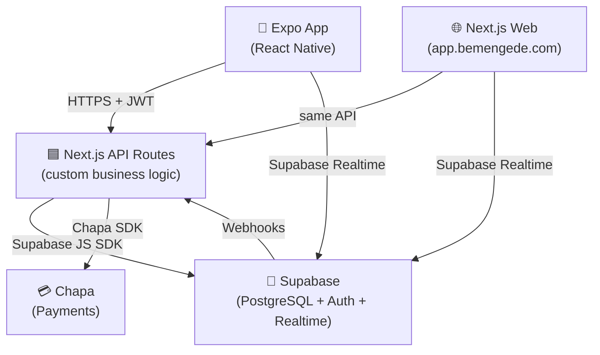
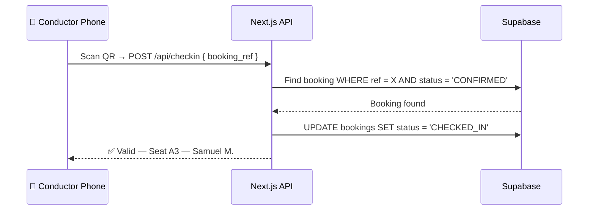

# 🚌 Bemengede — Professional System Design

> **Roles**: Guest Passenger · Operator · Super Admin
> **Booking philosophy**: No account required — pay to confirm, identity tied to your phone number.

> **Goal**: Rebuild the C++ terminal prototype into a professional bus booking platform.
> **Philosophy**: Solo-developer friendly. Maximum professionalism, minimum complexity.

---

## 1. Stack Decision — Solo Developer First

> Spring Boot + Java is powerful but heavy for one person. Here's a stack where **one language (TypeScript) runs everywhere** and Supabase handles the server infrastructure you'd otherwise have to manage yourself.

````carousel
### The Solo-Dev Professional Stack
| Layer | Choice | Why |
|-------|--------|-----|
| **Web Frontend** | **Next.js 14 (App Router)** | React-based, handles routing + API in one project |
| **Mobile** | **Expo React Native** | Shares 80% logic/types with Next.js. One codebase, two platforms. |
| **Backend / API** | **Next.js API Routes + Supabase Edge Functions** | No separate server to host or maintain |
| **Database** | **Supabase (PostgreSQL)** | Hosted, managed, automatic backups, free tier |
| **Auth** | **Supabase Auth — Google OAuth** | One button login. No OTP setup needed for now. |
| **Real-time** | **Supabase Realtime** | Live seat updates built into Supabase — zero extra config |
| **Payments** | **Chapa (Ethiopian)** | Local payment gateway — Telebirr, CBE, bank cards |
| **Language** | **TypeScript everywhere** | Same types shared frontend ↔ backend ↔ mobile |

<!-- slide -->
### Why Not Spring Boot?
Spring Boot is an **excellent industrial choice** — but for a solo developer:
- Requires managing a separate backend server + deployment
- Java + TypeScript + React Native = 3 different languages and ecosystems
- Higher DevOps overhead

**The Supabase approach gives you:**
- ✅ Hosted Postgres database
- ✅ Auth (Google OAuth, email, phone OTP — all built-in, add later)
- ✅ Realtime subscriptions (WebSocket managed for you)
- ✅ Auto-generated REST & GraphQL APIs from your schema
- ✅ Edge Functions for custom logic (TypeScript)

> When the project grows to a team, migrating to Spring Boot is straightforward since the database schema stays the same.
````

---

## 2. System Architecture



---

## 3. Database Schema (Supabase / PostgreSQL)

> Run this directly in the Supabase SQL editor. No CSV needed — cities and routes are **seeded from a TypeScript seed file** on first deploy.

```sql
-- Cities (seeded from JSON, not CSV)
CREATE TABLE cities (
    id UUID PRIMARY KEY DEFAULT gen_random_uuid(),
    name TEXT UNIQUE NOT NULL
);

-- Routes (one-way pair per direction)
CREATE TABLE routes (
    id UUID PRIMARY KEY DEFAULT gen_random_uuid(),
    origin_id UUID REFERENCES cities(id),
    destination_id UUID REFERENCES cities(id),
    distance_km INT,
    base_price_etb NUMERIC(10,2) NOT NULL,
    UNIQUE(origin_id, destination_id)
);

-- Physical buses
CREATE TABLE buses (
    id UUID PRIMARY KEY DEFAULT gen_random_uuid(),
    plate_number TEXT UNIQUE NOT NULL,
    total_rows INT NOT NULL,
    total_cols INT NOT NULL,
    bus_class TEXT DEFAULT 'ECONOMY'  -- 'ECONOMY', 'VIP'
);

-- A bus on a specific route at a specific date + time
CREATE TABLE schedules (
    id UUID PRIMARY KEY DEFAULT gen_random_uuid(),
    route_id UUID REFERENCES routes(id),
    bus_id UUID REFERENCES buses(id),
    departure_date DATE NOT NULL,
    departure_time TIME NOT NULL,
    arrival_time TIME,
    status TEXT DEFAULT 'SCHEDULED'   -- 'SCHEDULED','DEPARTED','CANCELLED'
);

-- One seat row per seat per schedule (generated when schedule is created)
CREATE TABLE seats (
    id UUID PRIMARY KEY DEFAULT gen_random_uuid(),
    schedule_id UUID REFERENCES schedules(id),
    label TEXT NOT NULL,              -- 'A1', 'B3'
    seat_class TEXT DEFAULT 'ECONOMY',
    is_booked BOOLEAN DEFAULT FALSE,
    UNIQUE(schedule_id, label)
);

-- Passenger profile (linked to Supabase Auth user)
CREATE TABLE passengers (
    id UUID PRIMARY KEY REFERENCES auth.users(id),
    full_name TEXT NOT NULL,
    phone TEXT,
    id_number TEXT,
    created_at TIMESTAMPTZ DEFAULT NOW()
);

-- Bookings — includes payment + cancellation tracking
CREATE TABLE bookings (
    id UUID PRIMARY KEY DEFAULT gen_random_uuid(),
    booking_ref TEXT UNIQUE NOT NULL,      -- 'BMG-20260224-0042'
    passenger_id UUID REFERENCES passengers(id),
    seat_id UUID REFERENCES seats(id),
    trip_type TEXT CHECK (trip_type IN ('ONE_WAY','ROUND_TRIP')),
    return_booking_id UUID REFERENCES bookings(id),

    -- Payment
    price_etb NUMERIC(10,2) NOT NULL,
    payment_status TEXT DEFAULT 'PENDING', -- 'PENDING','PAID','REFUNDED'
    chapa_tx_ref TEXT,                     -- Chapa transaction reference
    paid_at TIMESTAMPTZ,

    -- Cancellation
    cancelled_at TIMESTAMPTZ,
    cancellation_reason TEXT,
    refund_amount NUMERIC(10,2),

    booked_at TIMESTAMPTZ DEFAULT NOW(),
    status TEXT DEFAULT 'CONFIRMED'        -- 'CONFIRMED','CANCELLED','CHECKED_IN'
);

-- Waitlist
CREATE TABLE waitlist (
    id UUID PRIMARY KEY DEFAULT gen_random_uuid(),
    schedule_id UUID REFERENCES schedules(id),
    passenger_id UUID REFERENCES passengers(id),
    queued_at TIMESTAMPTZ DEFAULT NOW(),
    notified BOOLEAN DEFAULT FALSE
);
```

---

## 4. Booking Flow — No Account Required

> Anyone on any device can book a ticket. Identity is tied to **phone number** — no app, no account needed.

### Guest Booking Steps
```
1. Pick route, date, trip type
2. Pick seat
3. Enter: Full Name + Phone Number   ← this IS their identity
4. Pay via Chapa (Telebirr / CBE / card)
5. ✅ Booking confirmed → SMS with booking ref + QR code sent
```

> **Optional account**: Passengers who want to see booking history can sign up later with Google or phone. Their past bookings (matched by phone) get linked automatically.

### Cancellation & Refund Policy

> This is the industry-standard policy used by Flixbus, GoToBus, and Ethiopian Airlines.

| Time Before Departure | Refund Amount | How |
|----------------------|--------------|-----|
| More than **24 hours** | **90%** refund | Chapa reverse transfer within 3–5 days |
| **6–24 hours** before | **50%** refund | Chapa reverse transfer |
| Less than **6 hours** | **No refund** (travel credit only) | Credit stored in system, valid 60 days |
| **No-show** | No refund | Seat released after 15 min past departure |

> **Round-trip cancel**: If outbound is cancelled ≥24h before, return leg auto-cancels at 90%. If passenger already travelled outbound, return leg follows standard policy.

```typescript
// Cancel logic in /api/bookings/[ref]/cancel
const hoursUntilDeparture = differenceInHours(departureDateTime, now())

const refundPercent =
  hoursUntilDeparture > 24 ? 0.90 :
  hoursUntilDeparture > 6  ? 0.50 : 0.00

const refundAmount = booking.price_etb * refundPercent
// If refundPercent === 0 → issue travel credit instead
```

---

## 5. API Design (Next.js API Routes)

> Clean, readable, role-protected routes. All in TypeScript — same language as your frontend.

```
/api/
├── auth/
│   └── profile          POST   ← save name/phone after first Google login

├── cities               GET    ← all cities for search autocomplete

├── routes/
│   └── search           GET    ?from=&to=&date=&trip_type=

├── schedules/
│   └── [id]/
│       └── seats        GET    ← seat map (is_booked live via Realtime)

├── bookings/
│   ├──                  POST   ← create booking (ONE_WAY or ROUND_TRIP)
│   ├── [ref]            GET    ← get my booking by reference
│   └── [ref]/cancel     PATCH  ← cancel + trigger refund via Chapa

├── waitlist/
│   └──                  POST   ← join waitlist for a full schedule

└── admin/               (protected: admin role only)
    ├── schedules        POST / PUT
    ├── buses            POST
    └── reports          GET
```

---

## 6. One-Way vs Round-Trip

> When booking, user picks trip type upfront — the UI shows two date/seat pickers if ROUND_TRIP.

```typescript
// In /api/bookings/route.ts (Next.js)
async function createBooking(req: BookingRequest) {
  const outbound = await bookSeat(req.scheduleId, req.seatLabel, userId)

  let returnBooking = null
  if (req.tripType === 'ROUND_TRIP') {
    const returnSchedule = await findReturnSchedule(
      req.returnDate, req.destinationCityId, req.originCityId
    )
    returnBooking = await bookSeat(returnSchedule.id, req.returnSeatLabel, userId)

    // 10% discount on round trip return leg
    returnBooking.price_etb = returnBooking.price_etb * 0.9
    await linkReturnBooking(outbound.id, returnBooking.id)
  }

  const ref = generateRef('BMG') // e.g. BMG-20260224-0042
  await createPaymentIntent(ref, outbound.price_etb + (returnBooking?.price_etb ?? 0))

  return { booking_ref: ref, outbound, returnBooking }
}
```

---

## 7. Smart DSA Placements (TypeScript / Backend)

| DSA Concept | Where | Effect |
|-------------|-------|--------|
| **Trie** | City search autocomplete | Type "Ad" → instant suggestion of "Addis Ababa", "Adama" |
| **Min-Heap / Priority Queue** | Waitlist by priority (earliest queue time) | Fairness guarantee |
| **Dijkstra** | Multi-leg route suggestions | "No direct bus? Here's the cheapest 2-stop route" |
| **Greedy** | "Best seat" auto-suggestion | Prefer window, avoid middle, avoid last row |
| **HashMap** | `O(1)` seat lookup by label | Replace the O(n²) scan from the C++ version |

---

## 8. Screen Map

````carousel
### Auth + Home
```
📱 Bemengede App
│
├── 🔐 Auth
│   ├── WelcomeScreen     ← Logo, "Continue with Google" button
│   └── ProfileSetup      ← Enter name + phone (once, after first Google login)
│
└── 🏠 Home
    ├── SearchScreen       ← From / To city picker, Date, ONE-WAY or ROUND-TRIP toggle
    ├── ResultsScreen      ← Schedule cards: time, price, seats left, class
    ├── SeatPickerScreen   ← Interactive 2D seat grid (green=free, red=taken, live)
    │     └── [If ROUND_TRIP: shows return seat picker after outbound]
    ├── BookingConfirm     ← Summary: route, seat, price, trip type → Pay with Chapa
    └── TicketScreen       ← QR code + booking ref (shareable, saveable as image)
```

<!-- slide -->
### My Bookings + Admin
```
├── 📋 My Bookings
│   ├── BookingsListScreen  ← Upcoming / Past tabs
│   └── BookingDetail       ← View ticket, Cancel (shows refund amount), round-trip info
│
└── 👨‍💼 Admin / Operator (web panel — not in mobile app)
    ├── [Super Admin] Dashboard      ← system-wide revenue, routes, fleet
    ├── [Operator]    My Schedules   ← schedules assigned to their company
    └── [Conductor]   Today's Bus    ← manifest + QR scanner
```
> **Admin panel is a separate Next.js web page** in the same repo. Not in the mobile app — keeps the passenger app clean.
````

---

## 9. Admin & Operator System

> Three tiers of staff access, each with progressively narrower permissions.

### Role Hierarchy

```
Super Admin  →  full system control
    └── Operator  →  their company's routes & schedules only
            └── Conductor  →  today's assigned bus only
```

### Role Permissions Table

| Feature | Conductor | Operator | Super Admin |
|---------|:---------:|:--------:|:-----------:|
| View today's manifest | ✅ | ✅ | ✅ |
| Scan / validate QR tickets | ✅ | ✅ | ✅ |
| Mark passenger as checked-in | ✅ | ✅ | ✅ |
| Cancel / refund a booking | ❌ | ✅ | ✅ |
| Create / edit schedules | ❌ | ✅ (own routes) | ✅ |
| Add / edit buses | ❌ | ✅ (own fleet) | ✅ |
| View revenue reports | ❌ | ✅ (own only) | ✅ (all) |
| Manage cities & routes | ❌ | ❌ | ✅ |
| Create operator accounts | ❌ | ❌ | ✅ |
| Override any booking | ❌ | ❌ | ✅ |

### Database Changes for Roles

```sql
-- Staff accounts (separate from passenger auth)
CREATE TABLE staff (
    id UUID PRIMARY KEY REFERENCES auth.users(id),
    full_name TEXT NOT NULL,
    role TEXT CHECK (role IN ('SUPER_ADMIN','OPERATOR','CONDUCTOR')),
    company_name TEXT,          -- for OPERATOR role
    created_at TIMESTAMPTZ DEFAULT NOW()
);

-- Links a conductor to a specific schedule for a day
CREATE TABLE conductor_assignments (
    id UUID PRIMARY KEY DEFAULT gen_random_uuid(),
    conductor_id UUID REFERENCES staff(id),
    schedule_id UUID REFERENCES schedules(id),
    assigned_date DATE NOT NULL
);
```

### Admin Web Panel — Screen Map

````carousel
#### Super Admin Screens
```
/admin
├── /dashboard          ← KPIs: revenue, bookings today, occupancy %, active buses
├── /routes             ← Add/edit city pairs + base prices
├── /buses              ← Full fleet management
├── /schedules          ← All schedules across all operators
├── /bookings           ← Search any booking, override, force-cancel
├── /operators          ← Create operator accounts, assign routes
└── /reports            ← Revenue by route/date, export CSV
```

<!-- slide -->
#### Operator Screens
```
/operator
├── /dashboard          ← Today's departures, seats sold, revenue (own routes only)
├── /schedules          ← Their schedule list → create new schedule
├── /buses              ← Their bus fleet
├── /bookings           ← Search bookings on their routes, cancel with refund
└── /manifest/[id]      ← Full passenger list for a schedule → printable
```

<!-- slide -->
#### Conductor Screens (Mobile-friendly web page)
```
/conductor
├── /today              ← Today's assigned bus + departure info
├── /manifest           ← Passenger list (name, seat, booking ref, check-in status)
└── /scan               ← QR code scanner → validates ticket → marks CHECKED_IN
```
> The conductor view is a **mobile-responsive web page** they open on their phone — no separate app needed.
````

### QR Ticket Validation Flow



---

## 10. City/Route Data — Seed File (No CSV)

> Instead of parsing a CSV at runtime, seed your database **once** with a TypeScript file. Cleaner, type-safe, and version-controlled.

```typescript
// scripts/seed.ts  (run once: npx ts-node scripts/seed.ts)
const CITIES = [
  'Addis Ababa', 'Dire Dawa', 'Bahir Dar', 'Gondar',
  'Mekelle', 'Hawassa', 'Jimma', 'Adama', 'Dessie',
  'Debre Markos', 'Jijiga'
]

// Prices in ETB
const ROUTE_PRICES: Record<string, number> = {
  'Addis Ababa→Dire Dawa':  450,
  'Addis Ababa→Bahir Dar':  380,
  'Addis Ababa→Gondar':     520,
  // ... both directions
}

async function seed() {
  // Insert cities, then routes (both directions per pair)
  // This replaces routes.csv entirely
}
```

---

## 11. Phased Build Plan

| Phase | What | Time (Solo) |
|-------|------|------------|
| **1** | Supabase setup: schema + seed cities/routes + Google Auth | 2–3 days |
| **2** | Next.js project: route search + schedule display | 1 week |
| **3** | Seat picker screen + Supabase Realtime live updates | 3–4 days |
| **4** | Booking flow: one-way → Chapa payment → ticket screen | 1 week |
| **5** | Round-trip booking + cancel with refund | 3–4 days |
| **6** | Expo React Native app (reuse components from Next.js) | 1–2 weeks |
| **7** | Admin web panel (Super Admin + Operator + Conductor) | 1–2 weeks |
| **8** | DSA features: Trie autocomplete, Dijkstra multi-leg | 1 week |

> **Total realistic estimate for solo developer: ~8–10 weeks** for a fully working v1.

---

## 12. Additional Professional Recommendations

> These are not just nice-to-haves — they are what separate a student project from a real product.

| # | Feature | Why It Matters |
|---|---------|---------------|
| 1 | **Amharic + English UI** | Your users are Ethiopian. A bilingual app feels local and trustworthy. Next.js `next-intl` makes this straightforward. |
| 2 | **SMS booking confirmation** | Not everyone has a smartphone or email. Send booking ref + seat via SMS (use Africa's Talking API — supports Ethiopia). |
| 3 | **Offline ticket (PDF)** | Generate a PDF ticket passengers can screenshot or print. No internet needed at the bus gate. |
| 4 | **"Best seat" auto-suggestion** | When user opens the seat map, highlight the recommended seat (window, near front). Small UX detail, big impression. |
| 5 | **Dynamic pricing** | Seats become 20% more expensive when <10 left. Standard airline practice. Increases revenue automatically. |
| 6 | **Waitlist SMS notification** | When a cancellation opens a seat, immediately SMS the first person on the waitlist. First to click gets it. |
| 7 | **Travel credit system** | For <6h cancellations, issue credit (not cash). Creates return customers. Store as a `credits` table. |
| 8 | **Loyalty points** | 1 ETB spent = 1 point. 500 points = free seat upgrade. Keeps passengers coming back to Bemengede specifically. |
| 9 | **Revenue share for operators** | Bemengede takes 5% per ticket sold. Operators keep 95%. This is the business model. Track per-operator payouts. |
| 10 | **Accessibility** | Large text mode, screen reader support. Required in modern apps and distinguishes you from competitors. |

---

## 13. Summary Table

| | C++ Original | Bemengede v1 |
|--|--|--|
| Name | Selam Bus | **Bemengede** |
| Platform | Terminal | Web (Next.js) + Mobile (Expo) |
| Backend | Inline in main.cpp | Next.js API Routes + Supabase Edge Functions |
| Database | Flat .txt file | Supabase PostgreSQL |
| Auth | None | Google OAuth (+ phone OTP later) |
| Payments | None | Chapa (Telebirr, CBE, cards) |
| Real-time seats | None | Supabase Realtime |
| Route data | 3 hard-coded | 11 cities × all pairs, seeded via TypeScript |
| Trip types | One-way only | One-way + Round-trip |
| Cancel | By name (unsafe) | Name → phone confirm → pick → refund tracked |
| Solo-dev friendly | ✅ | ✅ (one language: TypeScript) |
