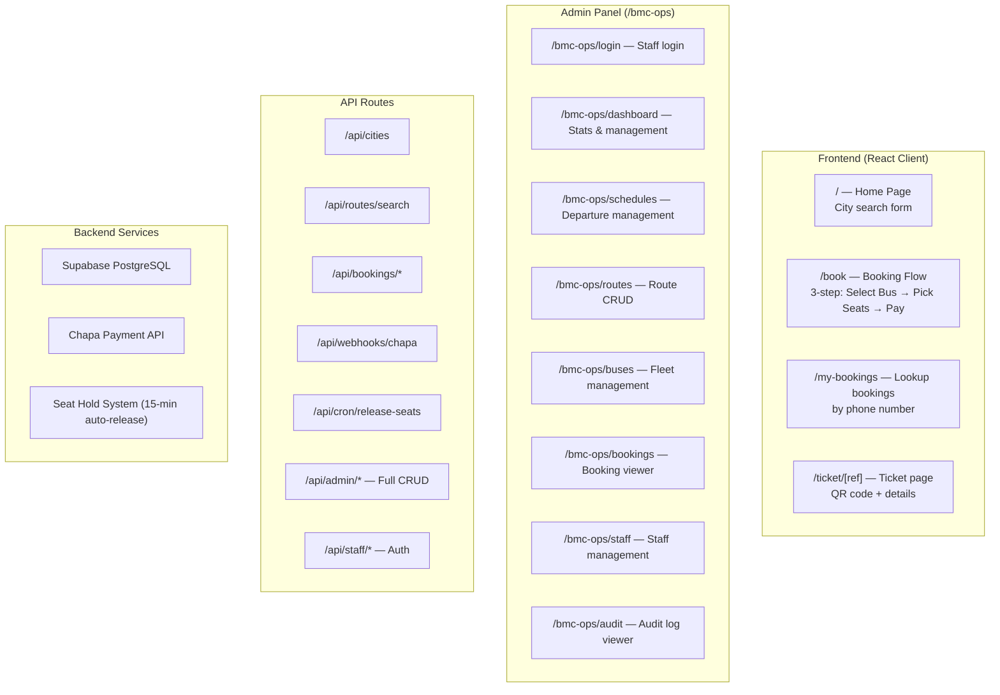

# 🚌 Bemengede Bus Booking System — Progress Walkthrough

**Last Updated:** July 1, 2026 | **Branch:** `main`

---

## What Is This Project?

**Bemengede** is a full-stack Ethiopian bus booking web application. Passengers can search routes between cities, pick seats on an interactive bus diagram, pay via **Chapa** (Ethiopian payment gateway), and receive QR-code tickets. An **admin panel** lets staff manage operations in full.

---

## Technology Stack

| Layer | Technology |
|---|---|
| **Framework** | Next.js (App Router) |
| **Language** | TypeScript |
| **Frontend** | React 19, Vanilla CSS (dark theme, glassmorphism) |
| **Database** | Supabase (PostgreSQL + Realtime) |
| **Auth (Admin)** | Custom JWT (`jose`) + `bcryptjs` password hashing |
| **Payments** | Chapa API (test mode) |
| **QR Codes** | `qrcode` library |
| **Deployment** | Vercel (with cron jobs) |
| **Font** | Outfit (Google Fonts) |

---

## Project Architecture



---

## Development Phases

| Phase | Commit | What Was Built |
|---|---|---|
| **1. Foundation** | `7c6e615` | Landing page, city selection |
| **2. Search** | `83bd837` | Search results page |
| **3. Seat Selection** | `4398f25 → 1223432` | Interactive seat picker, bug fixes |
| **4. Payments** | `ec01e2a` | Chapa integration, ticket page, validation |
| **4.5 Bug Fixes** | `3ad2238 → e86f0f1` | Race conditions, my-bookings, cancel flow |
| **5. My Bookings** | `ad437bf` | Verify payment, cancel past trips, expired tickets |
| **6. UI Overhaul** | `d57a790 → ea7b3b1` | Dark theme, glassmorphism, 3D seats, animations |
| **7. Admin Panel** | `b103119 + uncommitted` | Full admin panel — see below |

---

## Phase 7 — Admin Panel (Full Details)

### New Database Migration
- `migrations/002_admin_panel_fixed.sql` — **Safe idempotent migration**
  - Creates `staff` table (emp_number, full_name, password_hash, role, is_active)
  - Creates `audit_logs` table
  - Seeds first Super Admin: `SUPEMP001` / `Bemengede@2026`
  - Patches `schedules`, `bookings`, `buses` tables with missing columns
  - Enables Row Level Security (service_role only)

### New Library Files
- `src/lib/auth.ts` — JWT issuance/verification, bcrypt hashing, `getCurrentStaff()`, `logAudit()`, emp# generation
- `src/lib/seatHolds.ts` — Stale booking cleanup + Chapa payment verification

### New API Routes
| Route | Methods | Access |
|---|---|---|
| `/api/staff/login` | POST | Public |
| `/api/staff/logout` | POST | Authenticated |
| `/api/staff/me` | GET | Authenticated |
| `/api/admin/stats` | GET | ADMIN+ |
| `/api/admin/buses` | GET/POST/PUT/DELETE | SUPER_ADMIN |
| `/api/admin/routes` | GET/POST/PUT/DELETE | ADMIN+ |
| `/api/admin/schedules` | GET/POST/PUT/DELETE | ADMIN+ |
| `/api/admin/bookings` | GET/DELETE | ADMIN+ |
| `/api/admin/staff` | GET/POST/PUT/DELETE | SUPER_ADMIN |
| `/api/admin/audit` | GET | SUPER_ADMIN |

### Admin UI Pages
| Page | Role | Features |
|---|---|---|
| `dashboard` | ADMIN+ | 8 KPI stat cards, recent bookings table |
| `schedules` | ADMIN+ | Create departures, update status (SCHEDULED → IN_ROUTE → COMPLETED → CANCELLED) |
| `routes` | ADMIN+ | Manage city-to-city routes and pricing |
| `buses` | SUPER_ADMIN | Bus fleet, plate numbers, type, seat layout |
| `bookings` | ADMIN+ | View/filter/cancel passenger bookings |
| `staff` | SUPER_ADMIN | Create/edit/activate/deactivate staff accounts |
| `audit` | SUPER_ADMIN | Full action log with filtering |

---

## Database Schema

| Table | Purpose | Key Columns |
|---|---|---|
| **cities** | Ethiopian cities | `id`, `name` |
| **routes** | City-to-city routes | `id`, `origin_city`, `destination_city`, `base_price_etb` |
| **buses** | Registered buses | `id`, `plate_number`, `bus_type`, `total_rows`, `total_cols` |
| **schedules** | Specific departures | `id`, `route_id`, `bus_id`, `departure_date`, `departure_time`, `status` |
| **seats** | Per-schedule seats | `id`, `schedule_id`, `seat_number`, `is_booked` |
| **bookings** | Ticket records | `id`, `booking_ref`, `group_ref`, `seat_id`, `phone`, `price_etb`, `payment_status`, `status`, `chapa_tx_ref` |
| **staff** | Admin accounts | `id`, `emp_number`, `full_name`, `password_hash`, `role`, `is_active` |
| **audit_logs** | Action tracking | `id`, `staff_id`, `action`, `entity_type`, `entity_id`, `details`, `ip_address` |

---

## Features Completed ✅

### Passenger Side
- ✅ City search — origin/destination/date
- ✅ Route search — find available schedules
- ✅ Interactive seat picker — 2×2 layout with real-time updates (Supabase Realtime)
- ✅ Multi-seat booking — up to 10 seats per transaction
- ✅ Chapa payment — redirect + webhook confirmation
- ✅ QR code tickets
- ✅ My Bookings — phone-based lookup
- ✅ Cancel booking — tiered refund policy
- ✅ Seat hold timeout — 15-min auto-release via Vercel cron

### Admin Side
- ✅ Staff login — JWT, 8-hour sessions
- ✅ Dashboard — KPI stats overview
- ✅ Full CRUD: Buses, Routes, Schedules, Bookings, Staff
- ✅ Audit logging — all admin actions recorded
- ✅ Role system — ADMIN vs SUPER_ADMIN
- ✅ Rate limiting — 30 req/min/IP

### Security
- ✅ Security headers (CSP, HSTS, X-Frame-Options)
- ✅ Row Level Security on staff/audit tables
- ✅ Admin routes protected by JWT middleware
- ✅ Separate Supabase clients: anon (browser) vs service_role (API)

---

## Potential Next Steps

1. **Commit & push** the admin panel work (uncommitted)
2. **Run** `migrations/002_admin_panel_fixed.sql` in Supabase Dashboard
3. **Analytics charts** on the dashboard (Chart.js or Recharts)
4. **Email/SMS** ticket delivery
5. **Remove** orphaned `/search` page
6. **Error boundaries** on key pages
7. **Swap** Chapa test keys for production

---

## File Map

```
bemengede-web/
├── .env.local                        # Credentials (Supabase + Chapa)
├── vercel.json                       # Cron: release-seats every 5 min
├── migrations/
│   ├── 000_diagnostic.sql
│   ├── 001_add_group_ref.sql
│   ├── 002_admin_panel.sql
│   └── 002_admin_panel_fixed.sql     ← USE THIS
├── src/
│   ├── middleware.ts                  # Rate limiter + JWT admin guard
│   ├── lib/
│   │   ├── supabase.ts               # Browser anon client
│   │   ├── supabaseAdmin.ts          # Server service_role client
│   │   ├── auth.ts                   # JWT, bcrypt, audit, emp# gen
│   │   └── seatHolds.ts              # Stale seat cleanup
│   └── app/
│       ├── page.tsx                  # Homepage
│       ├── globals.css               # Design system
│       ├── book/page.tsx             # Booking flow
│       ├── my-bookings/page.tsx      # Phone lookup
│       ├── ticket/[ref]/page.tsx     # Ticket + QR
│       ├── bmc-ops/
│       │   ├── layout.tsx            # Admin shell + sidebar
│       │   ├── login/
│       │   ├── dashboard/page.tsx
│       │   ├── schedules/page.tsx
│       │   ├── routes/page.tsx
│       │   ├── buses/page.tsx
│       │   ├── bookings/page.tsx
│       │   ├── staff/page.tsx
│       │   └── audit/page.tsx
│       └── api/
│           ├── cities/
│           ├── routes/
│           ├── bookings/
│           ├── webhooks/chapa/
│           ├── cron/release-seats/
│           ├── admin/                ← NEW (buses, routes, schedules, bookings, staff, stats, audit)
│           └── staff/               ← NEW (login, logout, me)
```
